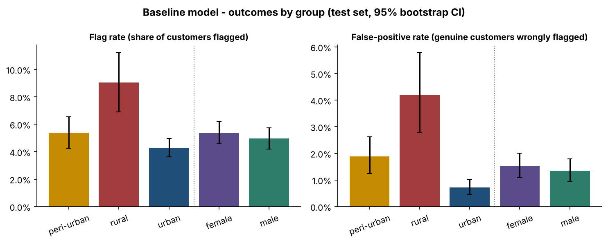
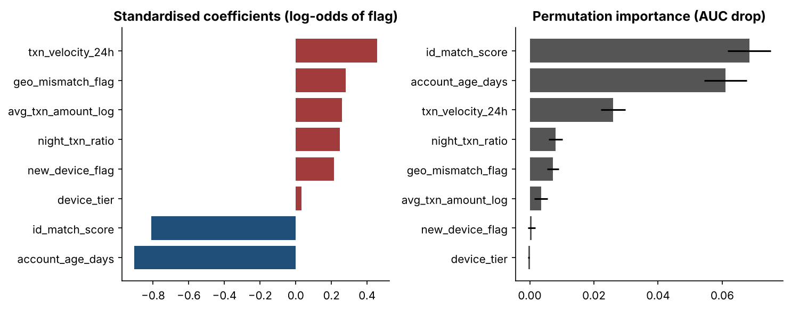
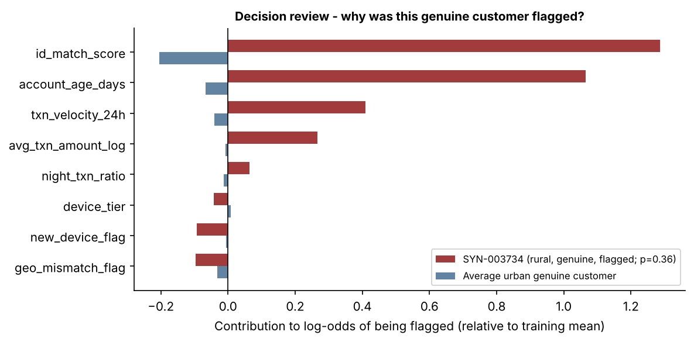
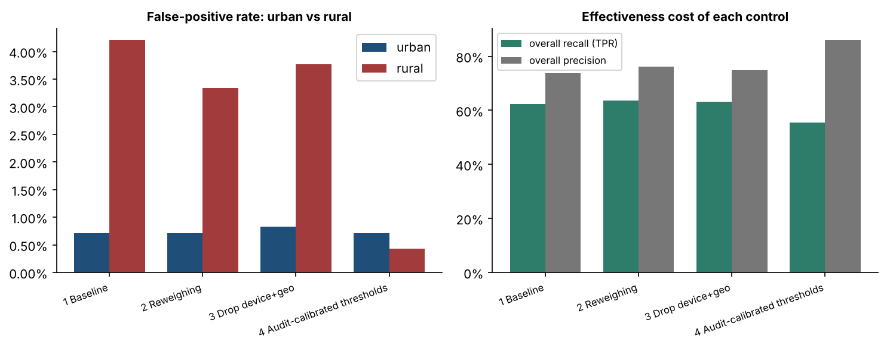
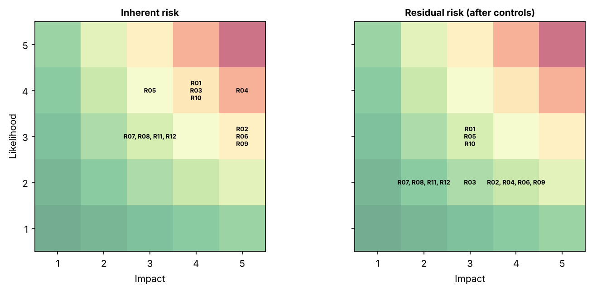

# Results summary

Generated by `python -m sfa_fairness.pipeline` (seed `20260611`, 20,000 synthetic records, 14,000 train / 6,000 test,
threshold 0.30). All values are on the **test set** and evaluated against the synthetic ground truth.
Full machine-readable output: [`metrics_summary.json`](metrics_summary.json) and [`tables/`](tables/).

## Baseline outcomes by region (95% bootstrap CI)

| Region | n | Flag rate | FPR (genuine wrongly flagged) | TPR |
|---|---|---|---|---|
| Urban (reference) | 3,734 | 4.3% (3.6-5.0) | **0.7%** (0.5-1.0) | 59.5% (53.0-65.6) |
| Peri-urban | 1,526 | 5.4% (4.3-6.6) | **1.9%** (1.2-2.6) | 62.5% (52.5-72.5) |
| Rural | 740 | 9.1% (6.9-11.2) | **4.2%** (2.8-5.8) | 74.5% (61.1-85.7) |

| Comparison vs urban | Statistical parity diff | Disparate-impact ratio | FPR ratio |
|---|---|---|---|
| Peri-urban | +1.1 pp | 1.25 | 2.6x |
| Rural | +4.8 pp | 2.11 | **5.9x** |

**Gender (control attribute):** FPR female 1.5% vs male 1.4% (ratio 1.13); disparate-impact 1.08; no material gap, as designed.

## Explainability findings
* `id_match_score` and `account_age_days` dominate (permutation AUC drop 0.068 and 0.061).
* Rural can be inferred from the model inputs (CV AUC **0.81**); without the three suspect features the AUC is 0.50, so the signal lives in `id_match_score` (0.71), `device_tier` (0.72) and `geo_mismatch_flag` (0.55).
* Among the 29 rural false positives, mean `id_match_score` contribution is **+1.26** log-odds vs **-0.21** for urban genuine customers.
* Counterfactual review: setting only `id_match_score` to a typical urban-genuine value un-flags **96.6%** of rural false positives; `device_tier` alone 0%; `geo_mismatch_flag` alone 27.6%.
* Dropping `device_tier` and `geo_mismatch_flag` therefore barely helps: the main driver is measurement bias in the ID-match signal.
* Scoring against the biased historical labels instead of the ground truth reverses the apparent TPR gap (rural 38% vs urban 49%) - label bias can mislead monitoring.

## Controls compared

| Variant | FPR urban | FPR rural | Rural/urban FPR | Disparate impact | Overall recall | Overall precision |
|---|---|---|---|---|---|---|
| 1 Baseline | 0.71% | 4.21% | 5.9x | 2.11 | 62.3% | 73.8% |
| 2 Reweighing | 0.71% | 3.34% | 4.7x | 1.86 | 63.7% | 76.1% |
| 3 Drop device + geo | 0.83% | 3.77% | 4.6x | 1.99 | 63.1% | 74.8% |
| 4 Audit-calibrated thresholds | 0.71% | 0.44% | 0.6x | 0.95 | 55.5% | 86.0% |

Option 4 equalises harm but lowers overall recall by 6.8 pp and rural recall from 74.5% to 52.9%; group-specific
thresholds also raise a legal-policy question. Fixing the ID-capture measurement problem at source is the preferred
long-term control.

## Figures
| | |
|---|---|
|  |  |
|  |  |
|  | |
